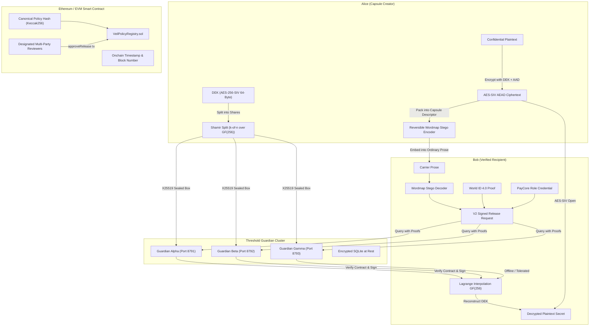

# VEIL — Protocol Architecture Specification

> **Event:** ETHGlobal Mumbai 2026  
> **Protocol:** VEIL — Programmable Secret Capsules  
> **Status:** Phase 8 Integrated Architecture

---

## 1. System Overview

VEIL solves the fundamental information-asymmetry dilemma: how to distribute encrypted sensitive data ahead of time across untrusted networks or content-filtered channels without allowing early disclosure, single points of failure, or unauthorized access.



---

## 2. Core Architectural Subsystems

### 2.1 Reversible Steganographic Codec (`packages/crypto/codec/wordmap.mjs`)
- Maps 256 distinct English vocabulary words in a 1-to-1 bijection with single bytes ($0x00 \dots 0xFF$).
- Preserves natural spacing, sentence framing, and punctuation.
- Encodes arbitrary binary descriptors into natural prose that passes standard content inspection filters without suspicion.
- Decodes reversibly with exact byte-for-byte fidelity without loss.

### 2.2 Capsule Cryptographic Engine (`packages/crypto/capsule.mjs`, `sss.mjs`)
- **Key Generation**: 512-bit Data Encryption Key (`crypto.getRandomValues(new Uint8Array(64))`) split into 256-bit MAC key and 256-bit encryption key.
- **Envelope Encryption**: AES-256-SIV AEAD envelope authenticated with RFC 5297 Synthetic IV.
- **AAD Policy Pinning**: The onchain policy hash `policyHash` is passed as Additional Authenticated Data (AAD). Altering any field of the policy invalidates authentication.
- **Shamir Secret Sharing**: Polynomial interpolation over Galois Field $GF(256)$ with polynomial $x^8 + x^4 + x^3 + x + 1$. Evaluated independently for each byte of the 64-byte key. Any $k$ of $n$ distinct shares reconstruct the key; $k-1$ shares reveal zero mathematical information about the key.

### 2.3 Smart Contract Policy Registry (`contracts/src/VeilPolicyRegistry.sol`)
- **Solidity Version**: `0.8.28` (EVM cancun).
- **Zero Plaintext Invariant**: Stores zero secret data, DEKs, or key shares. Stores only immutable commitments:
  - `capsuleId` (`bytes32`)
  - `creator` (`address`)
  - `ciphertextHash` (`bytes32`)
  - `policyHash` (`bytes32`)
  - `unlockTimestamp` (`uint64`)
  - `expiryTimestamp` (`uint64`)
  - `threshold` (`uint8`)
  - `approvalCount` (`uint8`)
- **State Transition Machine**:
  ```
  [CREATED] ──(approvals < threshold || time < unlock)──> [LOCKED]
      │
      ├──(approvals >= threshold && time >= unlock)────> [RELEASE_READY]
      │
      ├──(creator calls revokeCapsule)────────────────> [REVOKED]
      │
      └──(time > expiryTimestamp)─────────────────────> [EXPIRED]
  ```

### 2.4 Guardian Network Cluster (`packages/guardian/`)
- Three autonomous nodes running on dedicated ports:
  - Guardian Alpha: `http://127.0.0.1:8791` (Signer: `0x1111...`)
  - Guardian Beta: `http://127.0.0.1:8792` (Signer: `0x2222...`)
  - Guardian Gamma: `http://127.0.0.1:8793` (Signer: `0x3333...`)
- **Storage at Rest**: Encrypted SQLite using node-derived AES-256-SIV key with HKDF-SHA256 derivation.
- **Anti-Replay Mechanism**: Nonces and World ID nullifiers stored persistently. Replayed requests are immediately aborted.
- **Attestation Signatures**: Each released share is signed with the node's ECDSA private key and encrypted specifically to the recipient's ephemeral X25519 public key.

### 2.5 Multi-Layer Identity (`packages/crypto/identity/`)
- **World ID 4.0 Proof-of-Humanity**: Groth16 zero-knowledge proof verification over semaphore identity trees. The proof signal commits to `keccak256(recipientAddress || ephemeralPubkey)` to defeat Man-In-The-Middle (MITM) relay attacks.
- **Enterprise Role Authorization**: PayCore / Cerberus authority signatures verifying authorized job role (e.g. "Security Lead", "Key Custodian") pinned to the recipient's wallet.

---

## 3. Communication Protocols

| Interface | Protocol | Port / Location | Security Boundary |
|-----------|----------|-----------------|-------------------|
| Client $\leftrightarrow$ Node | In-Process / CLI | Local Sandbox | Memory isolation |
| Client $\leftrightarrow$ Guardians | HTTP / JSON | 8791, 8792, 8793 | X25519 Sealed Boxes + ECDSA Attestations |
| Client $\leftrightarrow$ Blockchain | JSON-RPC / Viem | 8545 / Testnet | secp256k1 Transaction Signatures |
| External App $\leftrightarrow$ API | REST / HTTP | 8088 | Rate-limiting + API Keys |
